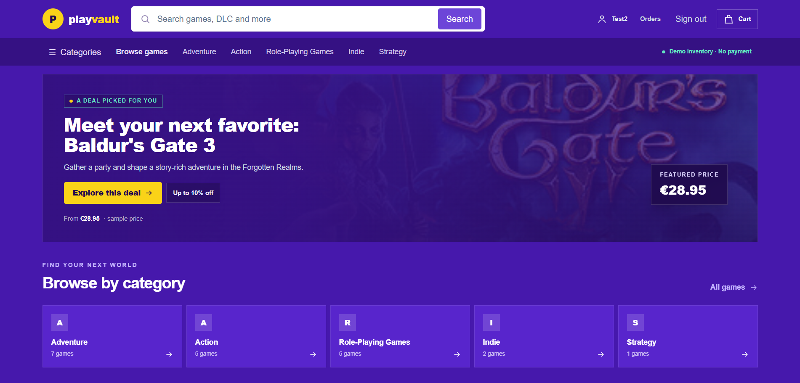
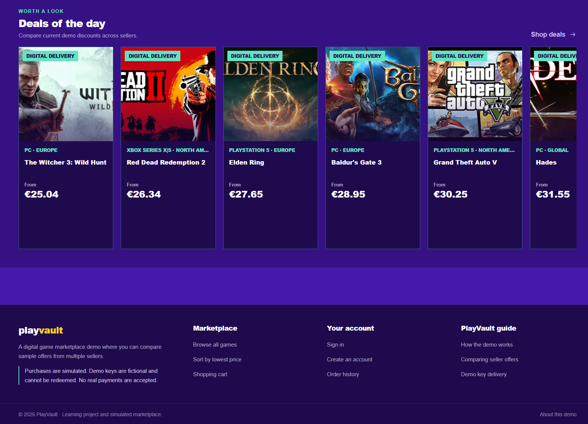
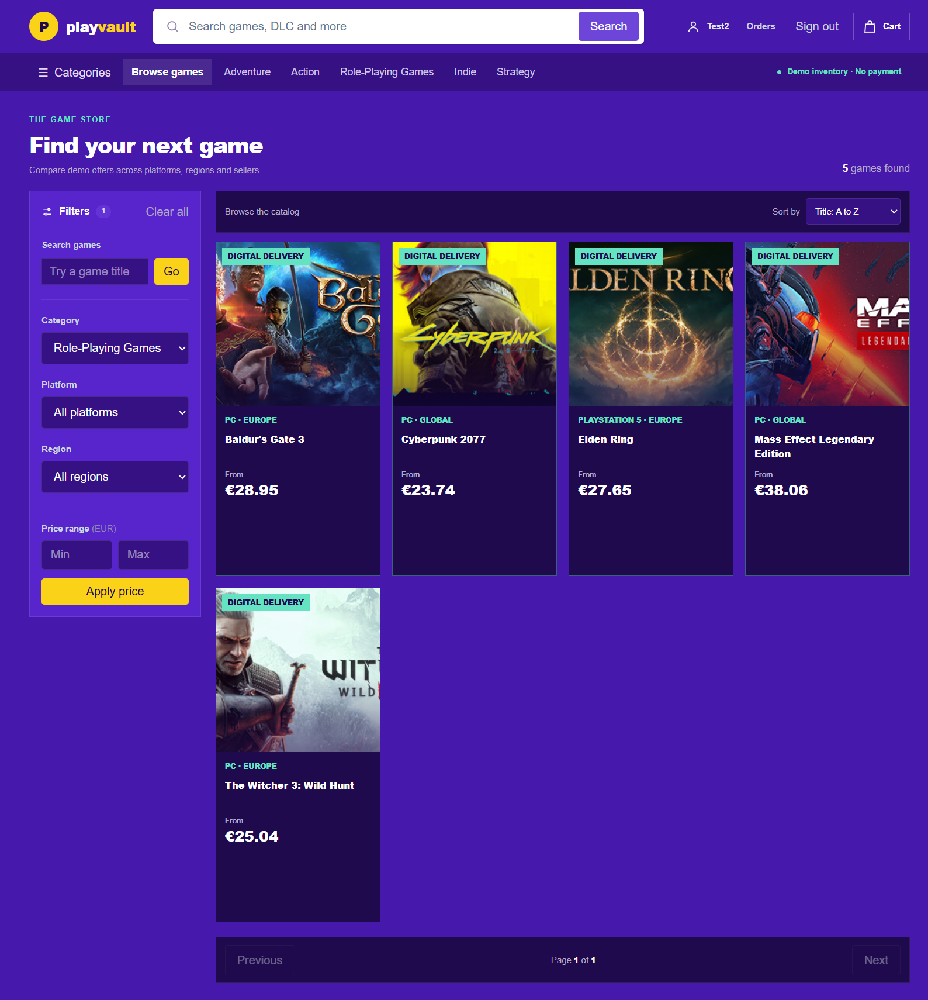
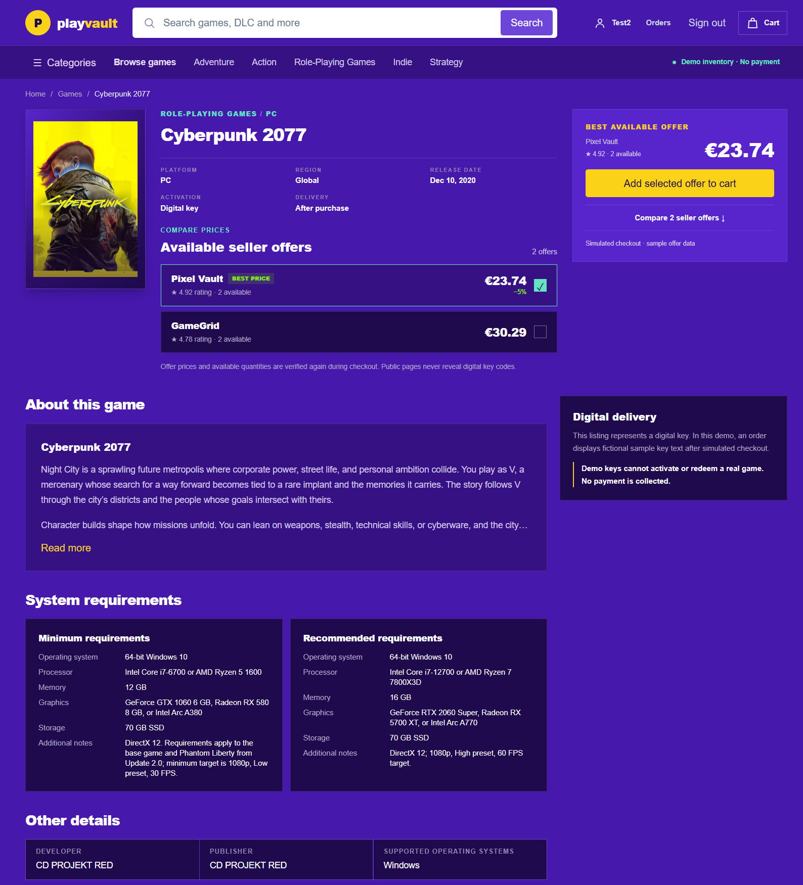
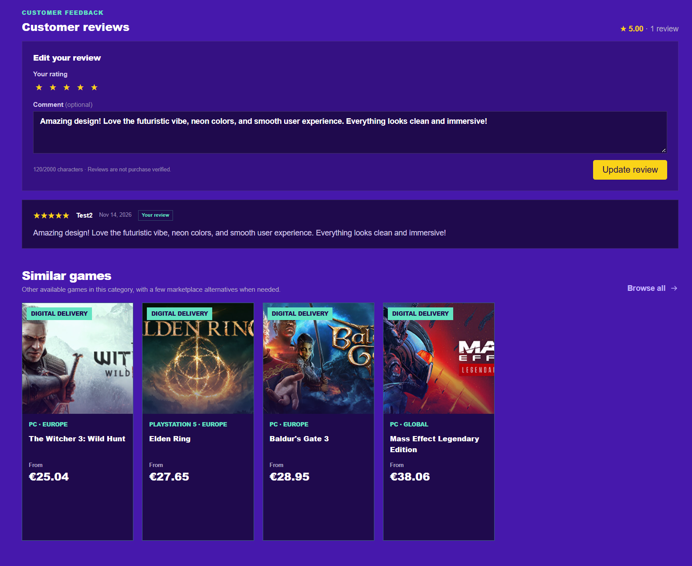
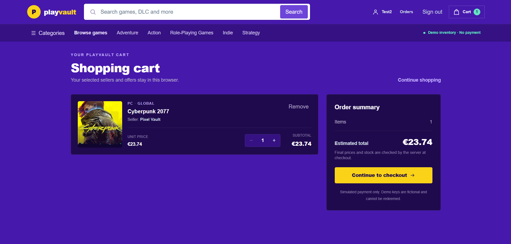
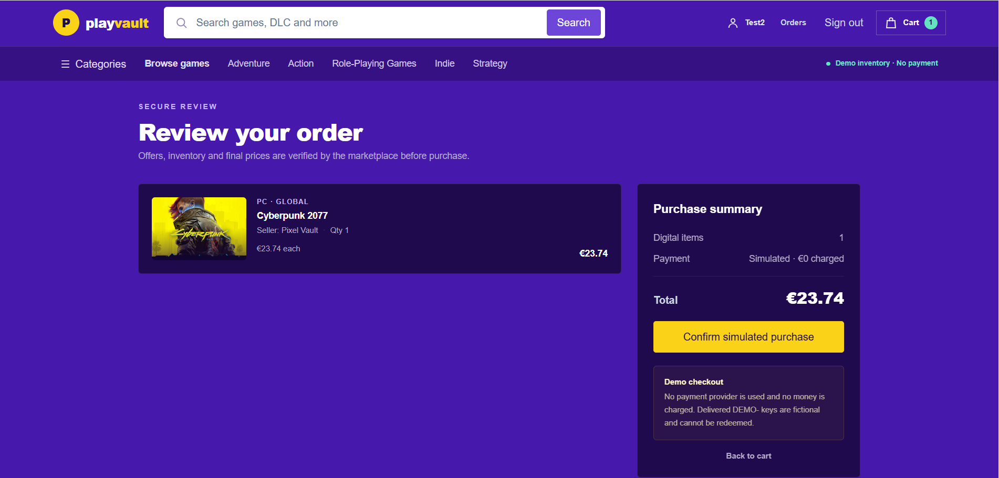
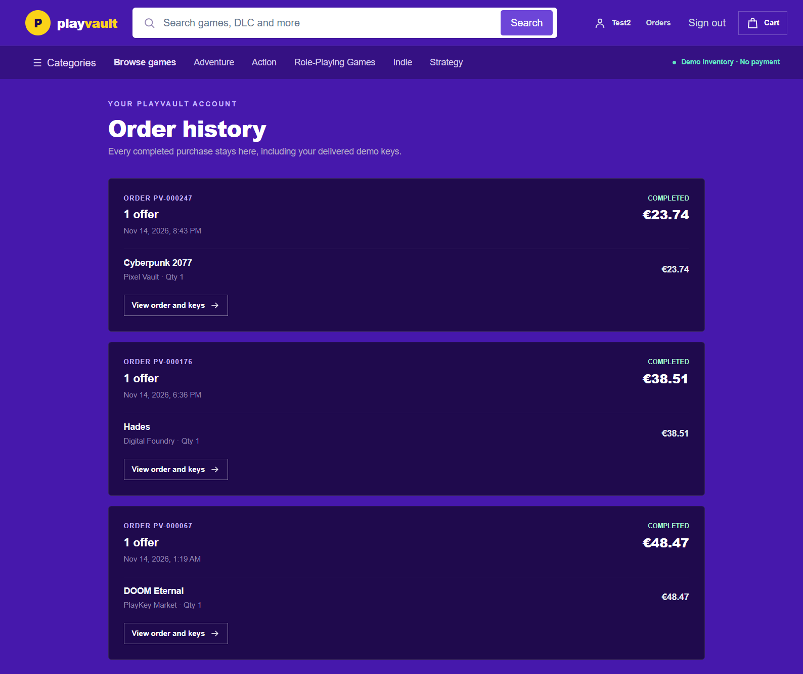
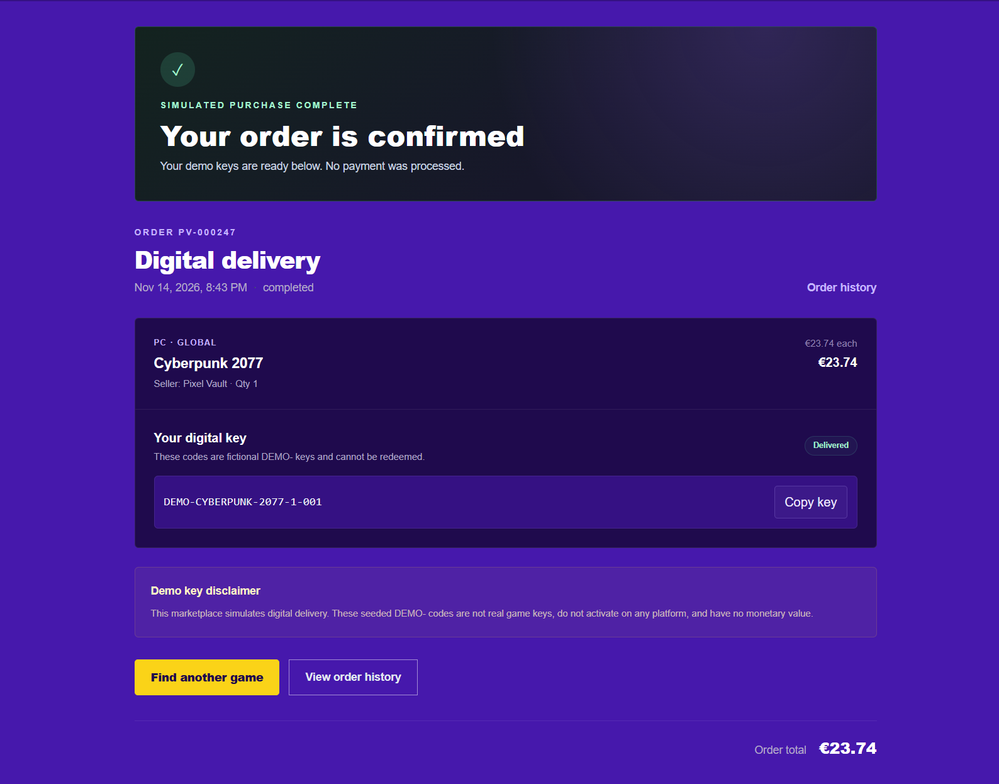

# PlayVault

PlayVault is an Eneba-inspired digital games marketplace built as an internship take-home assignment. It demonstrates a small full-stack marketplace using fictional products, sellers, offers, orders, and digital keys.

## What it includes

- API-driven homepage with promotions, categories, deals, and best sellers ranked by units in completed orders. Products without completed sales remain eligible and are ordered by available offer price, then title.
- Catalog search with partial names, aliases, typo tolerance, and autocomplete, plus category, platform, region, price, sorting, and pagination controls.
- Product pages with multiple seller offers, optional game information and system requirements, customer reviews, and related products.
- Registration and login using Laravel Sanctum session authentication; account-aware browser carts; simulated checkout; order history; and fictional digital key delivery.
- Responsive PlayVault interface, including account and marketplace information pages.

Checkout is simulated, all seeded inventory and digital keys are fictional, and the application collects no real payments. Keys cannot activate or redeem games. Do not enter real payment or customer information.

## Technology and architecture

- **Frontend:** React, TypeScript, Vite, React Router, Tailwind CSS 4.
- **Backend:** PHP 8.3+ and Laravel 13 with a JSON REST API.
- **Database:** PostgreSQL 18. Laravel owns catalog, offers, users, reviews, orders, and demo-key data. The frontend and backend run as separate applications; the browser cart is stored per guest or signed-in account in that browser.
- **Authentication:** Sanctum stateful session cookies and CSRF protection. Passwords and authentication tokens are not stored in frontend local storage.

The homepage reads its banner, best sellers, deals, and category data from the backend. Best-seller ranking counts quantities in completed orders rather than relying on hand-entered popularity values.

## Requirements

- Windows 10/11 with PowerShell.
- PHP 8.3 or later, Composer, and PHP extensions required by Laravel, including `fileinfo` and `pdo_pgsql`.
- Node.js 20.19+ or 22.12+ with npm.
- PostgreSQL 18 with a local database role able to create a database and the `pg_trgm` extension used by typo-tolerant search.
- Git for version control.

## Local setup (PowerShell)

Run commands in two PowerShell terminals. These instructions use the project root `C:\Projects\eneba-marketplace`, API port `8080`, and Vite port `5173`.

### 1. Create the local database

Start the PostgreSQL Windows service and create an empty database named `eneba_marketplace` using pgAdmin or your configured local PostgreSQL role. For example, after configuring `psql` access locally:

```powershell
createdb -U <your-local-role> eneba_marketplace
```

The migrations enable `pg_trgm`; the database role must be permitted to create that extension. Do not put a database password in a command, source file, or chat.

### 2. Configure and run the Laravel API

```powershell
Set-Location C:\Projects\eneba-marketplace\backend
Copy-Item .env.example .env
```

Edit `C:\Projects\eneba-marketplace\backend\.env` locally. Set `DB_DATABASE`, `DB_USERNAME`, and `DB_PASSWORD` for your PostgreSQL setup; keep credentials out of Git. The example uses `127.0.0.1:5432`. Then run:

```powershell
composer install
php artisan key:generate
php artisan migrate --seed
php artisan serve --host=127.0.0.1 --port=8080
```

Seeders populate the demo catalog, sellers, offers, and fictional keys. The frontend API URL and local Sanctum/CORS settings are provided as placeholders/default local origins in the example files. If either app uses a different host or port, update the corresponding local environment values to match. Keep `SESSION_DOMAIN` unset for local development and use the same hostname (`127.0.0.1`) for both apps.

### 3. Configure and run the React frontend

In the second terminal:

```powershell
Set-Location C:\Projects\eneba-marketplace\frontend
Copy-Item .env.example .env.local
npm ci
npm run dev -- --host 127.0.0.1 --port 5173
```

The example sets `VITE_API_BASE_URL=http://127.0.0.1:8080/api`. Vite variables are public browser configuration; never put secrets in them. Open [http://127.0.0.1:5173](http://127.0.0.1:5173). Laravel's health endpoint is [http://127.0.0.1:8080/api/health](http://127.0.0.1:8080/api/health).

The backend `.env.example` includes the local frontend origin in `SANCTUM_STATEFUL_DOMAINS` and `FRONTEND_URL`. Keep credentialed CORS restricted to the exact frontend origin; do not use a wildcard origin.

## Useful commands

From `backend/`:

```powershell
php artisan test
vendor/bin/pint --test
```

From `frontend/`:

```powershell
npm run lint
npm run build
```

Apply later additive database migrations with `php artisan migrate`. Use `php artisan migrate --seed` only for a local demo database; never run destructive reset commands against data you need to preserve.

## Screenshots

Below are screenshots showcasing the PlayVault marketplace and its main features.

### Homepage




### Game Catalog



### Product Details




### Cart and Checkout




### Order History and Digital Key Delivery




## Demo limitations

- Checkout does not process payment, and delivered keys are fictional demo strings.
- Product, seller, offer, and order data are sample/demo records rather than a live marketplace feed.
- The cart is browser-local rather than a server-side persistent cart.
- Review submission requires an account but does not require a verified purchase.
- This project is a demonstration and is not configured to handle real customers, payments, or redeemable keys.
